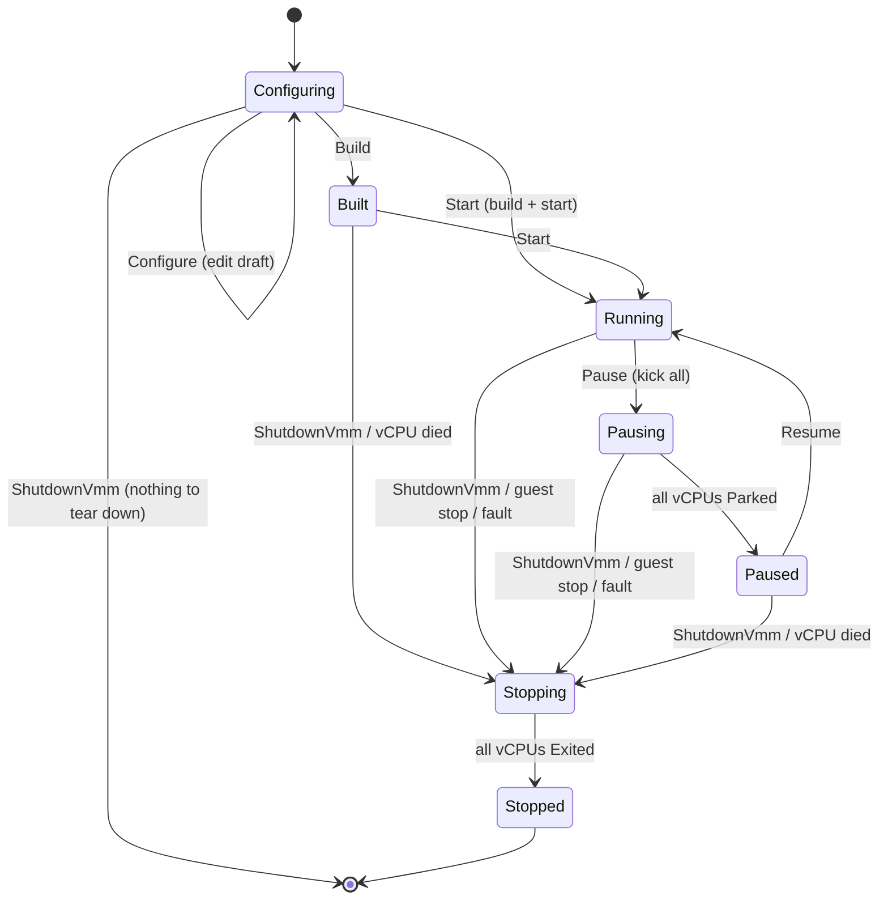

# VMM 生命周期: L1

> 状态: 设计草案, 等待推进下一阶段.
> 代码: `crates/vmm/src/lifecycle.rs` (只有类型和签名, 函数体都是 `todo!()`, 可以编译).
> 交互图: [lifecycle.html](lifecycle.html), 可以逐步发送 API 操作和 vCPU 上报, 观察阶段, 等待集合和回复.

## 0. 本阶段回答什么

L1 只回答三个问题:

1. 一台 VM 从配置到退出, 经过哪些阶段?
2. 每个阶段接受哪些操作, 拒绝哪些, 以什么理由拒绝?
3. 多个 vCPU 线程并发上报的事件, 和 API 请求交错时, 如何收敛成确定的结果?

快照, 热插拔, 热升级, 进程内重启不在 L1 实现. 第 9 节说明 L1 的类型怎样容纳它们, 以及每一步要加什么.

## 1. 需求与来源

每条需求都能指到代码, scope 或参考实现; 没有来源的设计不进 L1.

| # | 需求 | 来源 | 对模型的影响 |
|---|------|------|--------------|
| R1 | 启动前通过 `SetCpus`/`SetMemoryMib`/`SetConsole`/`SetBoot`/`AddDisk` 配置; 配置文件被展开成同一串命令回放 | `api::config::Config::parse`, `src/main.rs` `configure_vmm` | `Configuring(ConfigDraft)`; 配置操作是对草稿的纯函数编辑 `ConfigDraft::edit` |
| R2 | `Build` 和 `Start` 是两个操作 | `api::lifecycle::Build` 文档: "without running any vCPU" | 需要 `Built` 阶段: 资源已就绪, guest 从未运行 |
| R3 | `Start` 在未 build 时隐式 build | `api::lifecycle::Start` 文档 | `FromConfiguring::Build { then_start: true }` |
| R4 | 基线包含本地快照与恢复, 快照要求 vCPU 停住 | `docs/scope.md` 0.1 | 需要 `Paused`. 暂停要等所有 vCPU 离开 `KVM_RUN`, 这是异步的, 所以有显式过渡阶段 `Pausing` |
| R5 | guest 会主动停机: ACPI S5, i8042/CF9 复位, 三重错误, crash | `KVM_SYSTEM_EVENT_{SHUTDOWN,RESET,CRASH}` (`linux/include/uapi/linux/kvm.h:387-393`), `KVM_EXIT_SHUTDOWN` 即三重错误 (`kvm.h:160`, `arch/x86/kvm/vmx/vmx.c:5589`) | `StopReason`. L1 一律停机并退出进程, 与 Firecracker 一致 (`firecracker/FAQ.md:192, 205-209`) |
| R6 | N 个 vCPU 线程并发上报, 与 API 请求交错到达 | 每个 vCPU 一个线程 | `PauseTally`/`ExitTally` 收敛, 结果与到达顺序无关 |
| R7 | `ShutdownVmm` 在任何阶段可用; SIGINT/SIGTERM 映射到它 | `src/main.rs` | 每个阶段的规则都有 `Stop`/`Exit`/`Done` 出口 |
| R8 | 客户端超时不会取消已入队的请求, 客户端可能重试 | `VmmClient::call_timeout` 文档 | 目标态操作幂等: 已在目标阶段时回答 `Done` |
| R9 | 局部故障就地隔离 | `AGENTS.md` 架构约束 | 设备故障不进入生命周期; 只有 vCPU 无法继续时才停机; `Build` 失败回到 `Configuring`, 草稿保留 |
| R10 | vCPU 集合运行时可变 (CPU 热插拔) | `docs/scope.md` 0.2 | 等待集合是 `BTreeSet<VcpuId>`, 不是计数器或定长数组 |

参考对照:

- Cloud Hypervisor: `Created/Running/Shutdown/Paused/BreakPoint`, 没有过渡态, `Shutdown -> Running` 用于重启 (`cloud-hypervisor/vmm/src/vm.rs:327-371`).
- Firecracker: `NotStarted/Running/Paused` (`firecracker/src/vmm/src/vmm_config/instance_info.rs:9-17`); 快照只能在启动前加载, 加载后默认 `Paused`, `resume_vm` 决定是否继续 (`rpc_interface.rs:648-681`).

两者都把 "暂停是否完成" 藏在同步调用里. 本设计把它显式化, 原因见 3.3.

## 2. 阶段图



`Built` 和 `Paused` 的资源形态相同: vCPU 线程都已存在且停在用户态. 区别只在 guest 是否运行过, 这决定了 `Start` 和 `Resume` 哪个合法, 以及以后哪些操作可以不经热插拔协议直接生效 (见 9.3).

## 3. 两层结构

```
          API requests            vCPU reports
               │                       │
               ▼                       ▼
     ┌──────────────────────────────────────────────┐
     │  Machine::step(self, Input) -> (Machine, Replies)   ← 外壳: 持有资源, 执行副作用
     │    match self {                              │
     │      Running(vm) => match rules::running(&op) {     ← 决策层: 纯函数, 每阶段一个
     │        FromRunning::Pause => {               │
     │          let (vm, tally) = vm.pause();       │     ← typestate: Vm<Running> -> Vm<Pausing>
     │          Pausing { vm, tally, waiters }      │
     │        } ...                                 │
     └──────────────────────────────────────────────┘
```

### 3.1 决策层: 每个阶段一个规则函数

`rules::{configuring, built, running, pausing, paused, stopping}` 各自返回一个专属枚举 `From<Phase>`, 枚举里只有从该阶段真实存在的转移. 例如 `FromPaused` 没有 `Pause` 变体, `FromBuilt` 没有 `Resume`.

这避免了 "一个总的 `decide(phase, op) -> Decision`, 外壳再 `match (machine, decision)`" 的写法: 那种写法里 `(Paused, Decision::Start)` 之类的组合只能用 `unreachable!()` 兜底, 决策层和外壳之间的一致性完全靠人. 按阶段拆开后, 外壳的每个 `match` 都是穷尽且没有不可达分支的.

规则函数的输入只有操作本身, 不读时间, 不做 I/O. `configuring` 是唯一按值接收 `Op` 的规则: `FromConfiguring::Edit(ConfigEdit)` 把载荷原样交回, 外壳不需要再匹配一次操作.

vCPU 上报不经过规则函数: 过渡阶段交给 tally (3.3), 稳定阶段交给 `stray_report`.

### 3.2 外壳: typestate `Vm<S>` 加运行时和类型 `Machine`

`Vm<S>` 持有资源, `S` 是零大小标记 (`state::{Built, Running, Pausing, Paused, Stopping}`). 转移只在对应状态上存在:

| 方法 | 签名 | 说明 |
|------|------|------|
| `build` | `(&VmSpec, &ProcessCtx) -> Result<Vm<Built>>` | 所有可失败的启动步骤都在这里 |
| `start` | `Vm<Built> -> Vm<Running>` | 不可失败 |
| `pause` | `Vm<Running> -> (Vm<Pausing>, PauseTally)` | 踢出所有 vCPU |
| `settle` | `(Vm<Pausing>, AllParked) -> Vm<Paused>` | 需要 "全部已停" 的证明 |
| `resume` | `Vm<Paused> -> Vm<Running>` | |
| `stop` | `Vm<S: Stoppable> -> (Vm<Stopping>, ExitTally)` | `Stopping` 不是 `Stoppable`, 重复停机无法表达 |
| `reap` | `(Vm<Stopping>, AllExited) -> ()` | 需要 "全部已退出" 的证明 |

运行时阶段只有运行时才知道, 所以 VMM 循环持有和类型 `Machine`, 每个变体装一个 `Vm<S>` 和该阶段特有的数据 (tally, 等待者). `Machine::step` 按值接收 `self`: 每个分支把旧状态移进新状态, 不需要 `mem::replace` 用的占位状态, 也就不存在 "处于占位状态时被观察到" 的问题.

`Phase` 是 `Machine` 的投影, 即 API 里的 `VmState`.

### 3.3 为什么暂停和停机有显式过渡阶段

暂停 = 踢出每个 vCPU (信号加 `kvm_run.immediate_exit`, 避免踢和 `KVM_RUN` 进入的竞态), 然后等每个 vCPU 回报 `Parked`. 如果在处理 `Pause` 时直接 `await` 所有回报:

- 回报和 `Stop` 走同一个 vCPU 通道, 等待期间到达的 guest 停机事件需要另一套处理路径;
- 期间到达的 `ShutdownVmm` (例如 SIGTERM) 只能排队, 一个卡住的 vCPU 会让进程无法退出;
- 第二个 `Pause` 请求 (客户端超时重试, R8) 也只能排队.

所以等待本身作为状态存在: `Pausing { vm, tally, waiters }`. 对 `Pause` 的回复被推迟, 决策层只记录 `RequestId`, `Reply` 通道留在外壳. 停机同理: `Stopping { vm, tally }`.

`Built -> Running` 和 `Paused -> Running` 不需要过渡阶段: 让停住的线程继续跑不需要确认.

### 3.4 收敛: tally 与证明令牌

```rust
PauseTally { awaiting: BTreeSet<VcpuId>, stop: Option<StopReason> }
  record(self, vcpu, report) -> Self
  verdict(self) -> Pending(PauseTally) | Parked(AllParked) | Stop(StopReason)

ExitTally { awaiting: BTreeSet<VcpuId>, reason: StopReason }
  record(self, vcpu, report) -> Self
  verdict(self) -> Pending(ExitTally) | Exited(AllExited, StopReason)
```

- `record` 是交换的折叠: 同一组上报以任何顺序折叠, 得到同一个 tally. 来自不在 `awaiting` 中的 vCPU 的重复上报被吸收.
- `Stop` 优先于 `Parked`: 只要暂停期间有任何 vCPU 要求停机 (或线程意外退出), 结论就是 `Stop`, 停机请求不会被暂停吞掉.
- `AllParked`/`AllExited` 只能由 `verdict` 构造 (私有字段). `settle` 和 `reap` 要求这个令牌, 所以 "没等齐就宣布暂停完成" 写不出来.

令牌没有绑定到具体某台 VM 的 tally; 在单 VM 进程里这不构成问题. 若以后需要, 可以用 generative lifetime 打品牌.

### 3.5 `StopReason` 是半格

声明顺序就是诊断优先级: `GuestReset < GuestPowerOff < HostRequest < GuestCrash < VcpuFault{..}`. 合并用 `join = max`, 满足交换律, 结合律, 幂等律, 所以多个 vCPU 同时上报时, 最终原因与到达顺序无关. `VcpuFault` 内部按 `(vcpu, fault)` 排序, 平局也是确定的.

优先级的取舍: 故障比 guest 的请求信息量大; guest 关机强于复位 (编排方可能对复位做重启, 并发的关机应当胜出). 具体顺序可以再议, 只要是全序, 性质就成立.

三重错误归为 `GuestReset`: 物理机上三重错误就是复位, Linux 的 `reboot=t` 也有意用它.

### 3.6 可失败的部分都在 `build`

`build` 完成所有可能失败的工作: 创建 VM, 内存, 设备, vCPU, 加载内核, 写入 PVH 入口寄存器, 起好停住的 vCPU 线程. `start` 只是放行, 不可失败; 某个 vCPU 跑不起来时, 它以 `VcpuFault` 上报, 走正常的停机路径.

好处:

- `build` 失败时, 已创建的资源按字段顺序析构, `Machine` 仍是 `Configuring(draft)`, 用户可以改配置重试 (R9).
- 不存在 "启动到一半" 的状态, 不需要回滚部分已运行的 vCPU.
- 写入初始寄存器放在 `build`, 使 `Built` 和 `Paused` 的资源形态完全一致. 恢复快照时只是用快照里的寄存器替代 PVH 入口寄存器.

### 3.7 字段顺序即析构顺序

```rust
pub struct Vm<S> {
    vcpus: Vcpus,         // 1. vCPU 线程和 vCPU fd
    devices: Devices,     // 2. 设备
    vm_fd: VmFd,          // 3. VM fd: 关闭时 KVM 删除所有内存槽
    memory: GuestMemory,  // 4. 最后才 munmap
    ...
}
```

这条顺序保证没有 KVM 内存槽或设备活得比它指向的主机映射更久. 这是一条承重的不变量, 记录在类型注释里, 改字段顺序就是改语义. 注意 KVM 实例在最后一个 vCPU fd 也关闭后才销毁, 所以 vCPU 必须排在 VM fd 之前.

### 3.8 配置: 草稿和规格

`ConfigDraft` 所有字段可缺; `ConfigDraft::validate(&self) -> Result<VmSpec, Vec<ConfigProblem>>` 是纯函数, 一次报告所有问题. `VmSpec` 中 `boot: BootConfig` 不是 `Option`, `vcpus: NonZeroU32`: 能被 build 的配置才能被表示. `build` 借用 `VmSpec`, 失败不消耗草稿.

## 4. 转移表

### 4.1 操作

`Done` = 回复成功且阶段不变 (幂等); `Reject(x)` = 回复错误且阶段不变.

| 操作 \ 阶段 | Configuring | Built | Running | Pausing | Paused | Stopping |
|---|---|---|---|---|---|---|
| Configure | 编辑草稿 | Reject(ConfigFrozen) | Reject(ConfigFrozen) | Reject(ConfigFrozen) | Reject(ConfigFrozen) | Reject(ShuttingDown) |
| Build | build → Built; 失败留在原地 | Done | Reject(AlreadyStarted) | Reject(AlreadyStarted) | Reject(AlreadyStarted) | Reject(ShuttingDown) |
| Start | build + start → Running | start → Running | Done | Reject(Busy) | Reject(UseResume) | Reject(ShuttingDown) |
| Pause | Reject(NotBuilt) | Reject(NotBuilt) | pause → Pausing, 推迟回复 | Join, 推迟回复 | Done | Reject(ShuttingDown) |
| Resume | Reject(NotBuilt) | Reject(NotBuilt) | Done | Reject(Busy) | resume → Running | Reject(ShuttingDown) |
| ShutdownVmm | Exit | stop → Stopping | stop → Stopping | stop → Stopping, 等待者收到错误 | stop → Stopping | Done |

`Stopped` 之后循环结束, 不再处理输入.

`Pause` 在 `Built` 被拒绝而不是 `Done`: `Built` 的 vCPU 确实没在跑, 但 "暂停" 的后置条件是 `Paused`, 而 `Built` 不是 `Paused`, 回答 `Done` 会让客户端以为可以 `Resume`.

### 4.2 vCPU 上报

| 上报 \ 阶段 | Built / Paused | Running | Pausing | Stopping |
|---|---|---|---|---|
| Parked | 吸收 | 吸收 | tally: 移出 awaiting | 吸收 |
| Stop(r) | 不会发生 (线程停着) | stop(r) → Stopping | tally: join r → 结论 Stop | tally: join r |
| Exited | stop(VcpuFault{ThreadGone}) | stop(VcpuFault{ThreadGone}) | tally: join Fault → 结论 Stop | tally: 移出 awaiting |

`Pausing` 的结论为 `Stop(r)` 时: `vm.stop(r)` → `Stopping`, 所有等待者收到错误. 结论为 `Parked` 时: `vm.settle(proof)` → `Paused`, 所有等待者收到成功.

## 5. `step` 伪代码

```rust
fn step(self, input: Input, ctx: &ProcessCtx) -> (Machine, Replies) {
    match (self, input) {
        (Configuring(draft), Op(id, op)) => match rules::configuring(op) {
            Edit(edit)  => (Configuring(draft.edit(edit)), ok(id)),
            Build { then_start } => match draft.validate() {
                Err(problems) => (Configuring(draft), err(id, problems)),
                Ok(spec) => match build(&spec, ctx) {
                    Err(e) => (Configuring(draft), err(id, e)),
                    Ok(vm) if then_start => (Running(vm.start()), ok(id)),
                    Ok(vm) => (Built(vm), ok(id)),
                },
            },
            Exit => (Stopped(HostRequest), ok(id)),
            Reject(r) => (Configuring(draft), err(id, r)),
        },

        (Running(vm), Op(id, op)) => match rules::running(&op) {
            Pause => {
                let (vm, tally) = vm.pause();
                (Pausing { vm, tally, waiters: vec![id] }, none())
            }
            Done => (Running(vm), ok(id)),
            Stop => stopping(vm, HostRequest, ok(id)),
            Reject(r) => (Running(vm), err(id, r)),
        },
        (Running(vm), Vcpu(v, report)) => match stray_report(v, report) {
            Some(reason) => stopping(vm, reason, none()),
            None => (Running(vm), none()),
        },

        (Pausing { vm, tally, mut waiters }, Op(id, op)) => match rules::pausing(&op) {
            Join => { waiters.push(id); (Pausing { vm, tally, waiters }, none()) }
            Stop => stopping(vm, HostRequest, ok(id) + err_all(waiters, Stopped)),
            Reject(r) => (Pausing { vm, tally, waiters }, err(id, r)),
        },
        (Pausing { vm, tally, waiters }, Vcpu(v, report)) => match tally.record(v, report).verdict() {
            Pending(tally) => (Pausing { vm, tally, waiters }, none()),
            Parked(proof) => (Paused(vm.settle(proof)), ok_all(waiters)),
            Stop(reason) => stopping(vm, reason, err_all(waiters, Stopped)),
        },

        (Stopping { vm, tally }, Vcpu(v, report)) => match tally.record(v, report).verdict() {
            Pending(tally) => (Stopping { vm, tally }, none()),
            Exited(proof, reason) => { vm.reap(proof); (Stopped(reason), none()) }
        },

        // Built, Paused, Stopping 的操作分支同理, 见转移表.
    }
}

fn stopping<S: Stoppable>(vm: Vm<S>, reason: StopReason, replies: Replies) -> (Machine, Replies) {
    let (vm, tally) = vm.stop(reason);
    (Stopping { vm, tally }, replies)
}
```

VMM 循环:

```rust
let mut machine = Machine::Configuring(ConfigDraft::default());
loop {
    let input = select! {                      // mpsc::recv 是 cancel-safe 的
        req = api_rx.recv() => ...,            // 分配 RequestId, 把 Reply 存进 pending 表
        (vcpu, report) = vcpu_rx.recv() => Input::Vcpu(vcpu, report),
    };
    let (next, replies) = machine.step(input, &ctx);
    send(replies);                             // 按 RequestId 取出 Reply 发送
    if let Machine::Stopped(reason) = next { break exit_status(reason) }
    machine = next;
}
```

## 6. 不变量与性质

以下性质都能在决策层上用单元测试或性质测试覆盖, 不需要 KVM.

| # | 性质 | 层 |
|---|------|----|
| P1 | `StopReason::join` 满足交换律, 结合律, 幂等律 | 决策 |
| P2 | 对任意上报序列的任意排列, `PauseTally`/`ExitTally` 折叠结果相同 | 决策 |
| P3 | 暂停期间只要出现 `Stop` 或 `Exited`, 结论必为 `Stop`; 结论的原因 = 所有原因的 join | 决策 |
| P4 | 只有 `awaiting` 为空且无停机原因时, 才产生 `AllParked` | 决策 |
| P5 | `Reject` 和 `Done` 不改变阶段 | 决策 |
| P6 | 目标态操作幂等: 连续两次相同操作与一次效果相同 | 决策 |
| P7 | 每个 `RequestId` 恰好得到一次回复 (推迟的也一样, 在 settle 或 stop 时回复) | 外壳 |
| P8 | `phase(step(m, i))` 是 `phase(m)` 在阶段图上的合法后继 (外壳精化阶段图) | 外壳 |
| P9 | 在 `Configuring/Built/Paused/Stopped` 中没有 vCPU 处于 `KVM_RUN` | 外壳 |

P2 加 "vCPU 最终都会上报" 推出 `Pausing` 和 `Stopping` 最终会离开. 后者是活性假设, 需要第 8 节的超时兜底.

阶段图加 tally 的状态空间很小 (阶段 × awaiting 子集 × 原因), 适合以后用 TLA+ 或模型检查穷举, 不依赖具体工具.

## 7. API 改动

- `api::instance_info::VmState` 改为 `Configuring | Built | Running | Pausing | Paused | Stopping | Stopped`, 与 `Phase` 一一对应. 原 `NotStarted` 无法区分 "还在配置" 和 "已 build", 已删除.
- 建议新增 `lifecycle::Pause` (`POST /v1/pause-vm`) 和 `lifecycle::Resume` (`POST /v1/resume-vm`), 回复 `ApiResult<()>`. 本阶段没有改 `define_schema!`, 等实现 L1 时再加.

## 8. 未决问题

1. **卡住的 vCPU**: `Stopping` 没有超时, 一个卡在设备模拟里的 vCPU 会让进程无法退出. 建议加 `Input::Deadline(TimerId)`, 停机超时后直接结束进程 (线程随进程消亡); `Pausing` 超时则回复等待者 `Busy` 并保持 `Pausing` 还是回退到 `Running`, 需要决定.
2. **`build` 会阻塞**: 大内存 prefault 可能耗时数秒, 期间 `ShutdownVmm` 排队. 是否把 build 放到工作线程, 让 `Building` 成为过渡阶段?
3. **复位策略**: L1 把 `GuestReset` 当停机 (Firecracker 做法). Cloud Hypervisor 支持进程内重启. 若要支持, 正好可以用 "记录重放" 重建: 同一 `VmSpec` 加同一组分配记录.
4. **`Stopped` 后进程是否存活**: L1 立即退出. 若编排方需要在退出前查询原因, 需要保留进程直到 `ShutdownVmm`.
5. **`VmmExitStatus`**: 现在是 `anyhow::Result<()>`, 应当携带 `StopReason`, 由 main 映射到进程退出码.

## 9. 后续阶段 (由你推动)

### L2: 快照与恢复 (基线)

- `impl Vm<Paused> { fn save_snapshot(&self, ..) }`: 借用而非消耗, 签名本身表达 "快照不改变阶段, 且只在暂停时可做".
- 设备 DMA 也必须静止才能得到一致快照. `PauseTally` 的等待集合从 `VcpuId` 推广为 `Participant = Vcpu(VcpuId) | Device(DeviceId)`, 设备工作线程也回报 `Parked`.
- `Configuring` 拆成 `Fresh` 和 `Drafting(ConfigDraft)`: 恢复只能从 `Fresh` 发起 (同 Firecracker 的约束), 由类型而不是 "是否改过配置" 的布尔量表达.
- 恢复 = `build` 的另一条入口: 用快照里的记录 (内存布局, 分配记录, vCPU 寄存器) 代替规划, 产出 `Vm<Paused>`.
- 快照只包含 guest 可见的数据; 主机本地的部分 (路径, fd, 内存槽号) 在恢复时重新提供或重新推导. 见 memory.md 第 2 节.

### L3: 运行时变更 (热插拔)

- `Running` 下的 `AddDisk` 不是 "解冻配置", 而是另一族操作: 带 guest 握手 (ACPI GED 通知, 弹出确认) 的事务. 规则返回 `FromRunning::Hotplug(..)`, 外壳持有进行中的事务.
- `Built` 下添加设备可以直接冷插: guest 尚未枚举 PCI. 这是保留 `Built` 和 `Paused` 区分的另一个理由.
- CPU 热插拔改变 `Vcpus` 和 tally 的期望集合; tally 已经是集合, 不需要改结构.

### L4: 热升级与迁移

- `impl Vm<Paused> { fn hand_over(self) -> (HandoverPackage, Departed) }`: 消耗 VM. 旧进程得到的 `Departed` 不含任何资源, 所以 "交出后又恢复运行" 在类型上不可表达.
- precopy 在 `Running` 下进行脏页迭代, 最后暂停并交出, 终态同样是 `Departed`. 迁移期间冻结内存布局, 见 memory.md 的 M4.
- 交接协议先写 TLA+ 规约 (AGENTS.md 要求).
